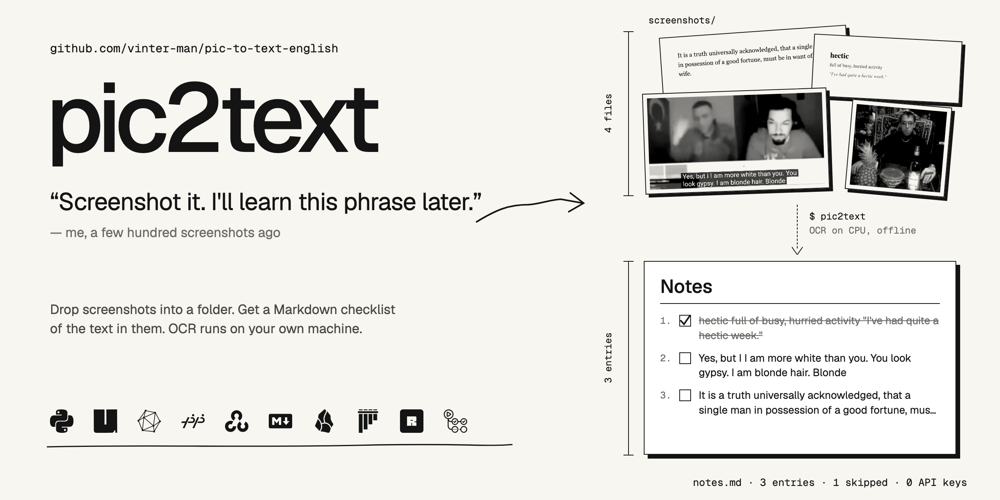
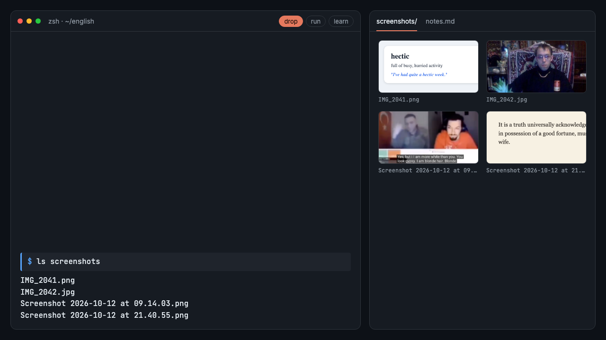
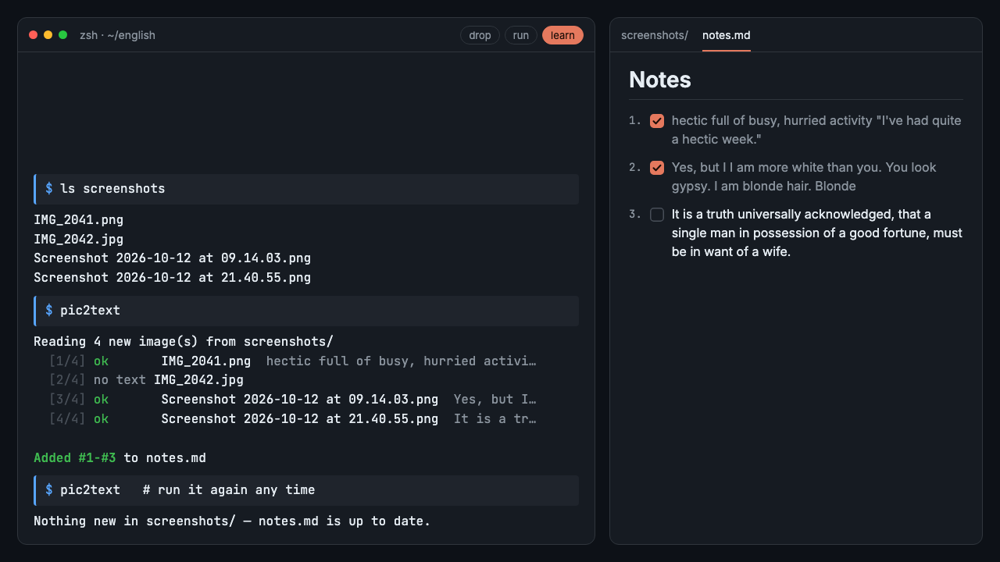

[](https://github.com/vinter-man/pic-to-text-english/actions/workflows/ci.yml)


[](LICENSE)



## Short description
You see a good English phrase in a book, a chat or a talk caption. You take a screenshot. You never look at it again.

pic2text fixes the last part. Throw the screenshots into a folder, run one command, and get a numbered Markdown checklist with the text from every picture. Tick the phrases off as you learn them.

OCR runs on your own machine. No API keys, no uploads, no 2 GB of PyTorch. Run it as often as you like: it only reads new screenshots and never adds the same one twice.


---

## Table of contents

* [How I use it](#how-i-use-it)
  * [Drop screenshots](#drop)
  * [Run it](#run)
  * [Learn](#learn)
* [Installation](#installation)
* [Options](#options)
* [Contact](#contact)

---
---

## <a name="how-i-use-it"></a> How I use it
### <a name="drop"></a> Drop screenshots
I read a book, scroll a chat or watch a talk with subtitles, and as soon as a phrase is worth stealing, I take a screenshot. At the end of the week they all go into one folder



PNG, JPG, WebP, BMP and TIFF are all fine. Names don't matter

### <a name="run"></a> Run it
```
cd ~/english
pic2text
```


> :suspect: Under the hood:
> - every image gets a fingerprint (SHA-256 of its bytes), and fingerprints already in `notes.md` are skipped. Rename a file or save it twice, still no duplicate. If nothing is new, the model isn't even loaded
> - OCR is [RapidOCR](https://github.com/RapidAI/RapidOCR): PaddleOCR's PP-OCR models on ONNX Runtime. The models ship inside the wheel, so after install it works without internet
> - fragments with a low confidence score are thrown away. They're almost always avatars and icons read as `:o:`
> - the remaining lines are glued into one paragraph, and `multi-` + `hundred` become `multi-hundred` again
>
> `src/pic2text/cli.py` → `ocr.py` → `document.py`, about 270 lines in total

### <a name="learn"></a> Learn
Open `notes.md` in Obsidian, VS Code, Typora or right here on GitHub. It's a plain checklist



The file only ever grows, and the next run continues the numbering from wherever you are

> :hurtrealbad: Every line has an HTML comment with the fingerprint of its screenshot. You can't see it when the file is rendered, but you can see it in the raw file, so you always know where a phrase came from:
> ```markdown
> 2. [ ] Yes, but I I am more white than you. You look gypsy. I am blonde hair. Blonde <!-- pic2text ae0ade280303 Screenshot 2026-10-12 at 09.14.03.png -->
> ```
> Screenshots with no text get a comment-only line, so they aren't read again either. The file that example came from is [`examples/notes.md`](examples/notes.md)

---
---

## <a name="installation"></a> Installation
Install [uv](https://docs.astral.sh/uv/getting-started/installation/). It brings the right Python by itself
```
uv tool install git+https://github.com/vinter-man/pic-to-text-english
```
> `pipx install git+https://github.com/vinter-man/pic-to-text-english` works the same way

The first run takes a couple of seconds to load the model. After that it's under a second per screenshot on a laptop CPU, with no GPU needed

## <a name="options"></a> Options
```
pic2text [folder] [-o OUTPUT] [--title TITLE] [--min-confidence 0-1]
```

| Option | Default | What it does |
| --- | --- | --- |
| `folder` | `./screenshots` | where to look for images (not recursive) |
| `-o, --output` | `./notes.md` | the Markdown file to create or append to |
| `--title` | `Notes` | the heading written when the file is created |
| `--min-confidence` | `0.75` | drop OCR fragments scored below this |

A separate list for every book
```
pic2text ~/Pictures/dune -o dune.md --title "Dune: phrases"
```
Straight into the Obsidian vault
```
pic2text ~/Desktop/screens -o ~/Obsidian/English/inbox.md
```
Garbage from icons in the output? Raise the threshold. Words missing from a blurry phone photo? Lower it
```
pic2text --min-confidence 0.9
pic2text --min-confidence 0.5
```

---
---

## <a name="contact"></a> Contact

GitHub: [vinter-man](https://github.com/vinter-man)

License: MIT, take it and learn
