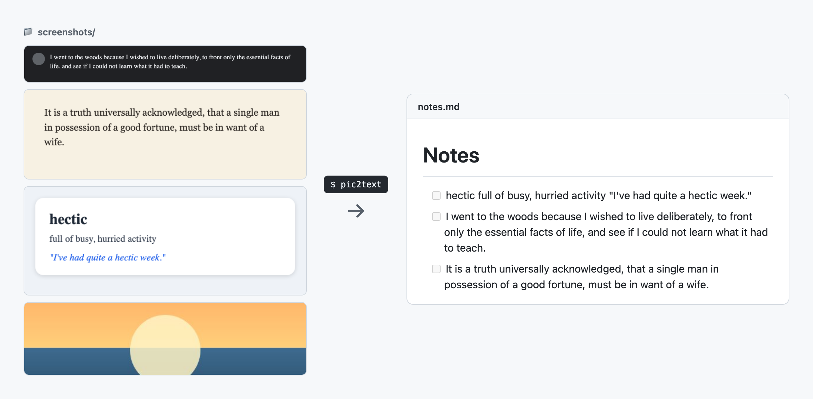
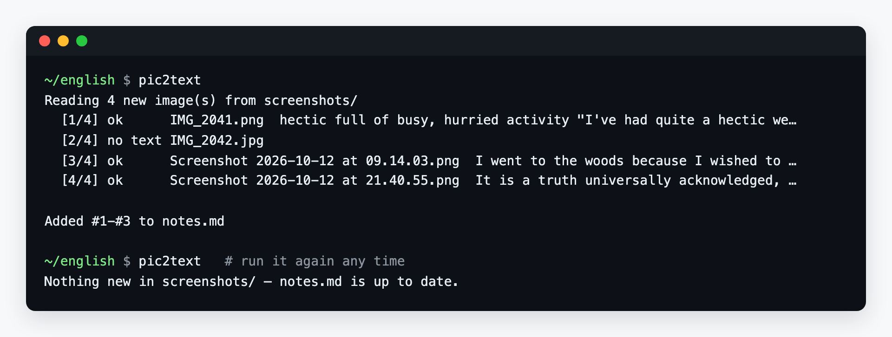

# pic2text

[](https://github.com/vinter-man/pic-to-text-english/actions/workflows/ci.yml)

[](LICENSE)

Drop screenshots into a folder, run one command, get a numbered Markdown checklist of the text in them.

I built it for learning English: every time I saw a phrase worth remembering (in a book, a chat, a talk caption, a flashcard app) I took a screenshot. Retyping them was the part I never got to. Now it's one command.



- **Offline.** OCR runs locally on [RapidOCR](https://github.com/RapidAI/RapidOCR) (PP-OCR models on ONNX Runtime). No API keys, nothing leaves your machine, no PyTorch download.
- **Safe to re-run.** It only reads images it hasn't seen before. Renaming a screenshot or saving it twice won't add a duplicate.
- **Your edits stay.** The file only grows. Tick items off, reword them, add your own: the next run appends below and keeps the numbering going.

## Quick start

**1. Install.** You need [uv](https://docs.astral.sh/uv/getting-started/installation/) (or use `pipx` the same way):

```bash
uv tool install git+https://github.com/vinter-man/pic-to-text-english
```

**2. Make a folder and drop screenshots into it.** PNG, JPG, WebP, BMP and TIFF all work.

```bash
mkdir -p ~/english/screenshots && cd ~/english
```

**3. Run it.**

```bash
pic2text
```



**4. Open `notes.md`.** It renders as a checklist on GitHub, in Obsidian, VS Code, Typora and most other Markdown editors. See [`examples/notes.md`](examples/notes.md) for the file produced from [`examples/screenshots/`](examples/screenshots).

Add more screenshots whenever you like and run `pic2text` again. New text is appended as `#4`, `#5`, …

## Options

```text
pic2text [folder] [-o OUTPUT] [--title TITLE] [--min-confidence 0-1]
```

| Option | Default | What it does |
| --- | --- | --- |
| `folder` | `./screenshots` | Where to look for images (not recursive) |
| `-o, --output` | `./notes.md` | Markdown file to create or append to |
| `--title` | `Notes` | Heading written when the file is created |
| `--min-confidence` | `0.75` | Drop OCR fragments scored below this. Raise it if icons show up as stray characters; lower it for blurry photos |

For example, to keep a separate list per book:

```bash
pic2text ~/Pictures/dune -o dune.md --title "Dune: phrases"
```

## How it works

1. Images in the folder are sorted the way a file manager sorts them (`img_2` before `img_10`).
2. Each image is fingerprinted (SHA-256 of its bytes). Fingerprints already recorded in the output file are skipped.
3. RapidOCR returns the text lines with a confidence score. Low-scoring fragments (usually avatars and icons) are dropped. The rest are joined into one paragraph, and words broken at a line-end hyphen are put back together.
4. Each result becomes a line like this:

   ```markdown
   2. [ ] I went to the woods because I wished to live deliberately, … <!-- pic2text 761863ec1ed7 Screenshot 2026-10-12 at 09.14.03.png -->
   ```

   The HTML comment is invisible when rendered. It's how the next run knows the image is already in the file, and it tells you which screenshot the line came from. Images with no text get a comment-only line, so they aren't read again either.

## Limitations

- It reads everything visible: a sender's name, a timestamp, a page number. Crop the screenshot to the phrase you want, or edit the line afterwards.
- One screenshot becomes one paragraph. Layouts with columns or tables come out as a single line of text.
- The bundled models are tuned for English (Latin script). Other languages are out of scope for now.

## Development

```bash
git clone https://github.com/vinter-man/pic-to-text-english && cd pic-to-text-english
uv sync
uv run pytest              # unit tests + a real OCR pass over examples/screenshots
uv run pytest -m "not ocr" # unit tests only, no model load
uv run ruff check . && uv run ruff format --check .
```

CI runs the same checks on Linux, macOS and Windows with Python 3.11 and 3.14.

The example screenshots contain public-domain text (Thoreau's *Walden*, Austen's *Pride and Prejudice*) and a made-up flashcard.

## License

[MIT](LICENSE)
