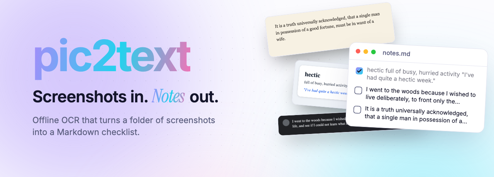
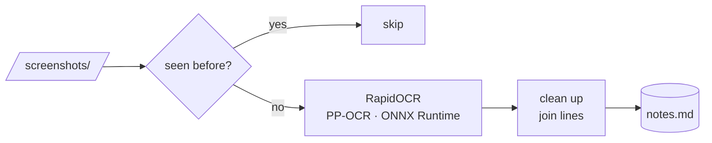

<picture>
  <source media="(prefers-color-scheme: dark)" srcset="docs/banner-dark.png">
  
</picture>

<p align="center">
  <a href="https://github.com/vinter-man/pic-to-text-english/actions/workflows/ci.yml"></a>
  
  
  <a href="https://docs.astral.sh/uv/"></a>
  <a href="LICENSE"></a>
</p>

<p align="center">
  <b>Drop screenshots into a folder. Run one command. Get a Markdown checklist of the text in them.</b><br>
  Local OCR, no API keys, and re-running never adds duplicates.
</p>

<p align="center">
  <a href="#quick-start">Quick start</a> ·
  <a href="#what-you-get">What you get</a> ·
  <a href="#how-it-works">How it works</a> ·
  <a href="#options">Options</a> ·
  <a href="#development">Development</a>
</p>

<p align="center">
  
</p>

## Why

I learn English by collecting phrases. Whenever I saw one worth keeping (in a book, a chat, a talk caption, a flashcard app) I took a screenshot, and I never got round to retyping them. pic2text turns that folder into a list I can work through and tick off.

<table>
  <tr>
    <td width="33%" valign="top"><b>Private by default</b><br>OCR runs locally with <a href="https://github.com/RapidAI/RapidOCR">RapidOCR</a> (PP-OCR models on ONNX Runtime). Your screenshots never leave the machine, and you don't need PyTorch or a GPU.</td>
    <td width="33%" valign="top"><b>Safe to re-run</b><br>Each image is fingerprinted, so the next run reads only new screenshots. Renaming a file or saving it twice won't add a duplicate.</td>
    <td width="33%" valign="top"><b>Your edits stay</b><br>The file is only ever appended to. Tick items off, reword them, add your own lines, and numbering carries on from where you are.</td>
  </tr>
</table>

## Quick start

**1. Install** with [uv](https://docs.astral.sh/uv/getting-started/installation/) (`pipx install` works the same way):

```bash
uv tool install git+https://github.com/vinter-man/pic-to-text-english
```

**2. Drop screenshots into a folder.** PNG, JPG, WebP, BMP and TIFF are supported.

```bash
mkdir -p ~/english/screenshots && cd ~/english
```

**3. Run it.** The first run takes a second or two to load the model. After that it's under a second per image on a laptop CPU.

```bash
pic2text
```


<sub>That recording is real: <a href="demo/demo.tape"><code>demo/demo.tape</code></a> runs the CLI on <a href="examples/screenshots"><code>examples/screenshots</code></a>.</sub>

## What you get

`notes.md` is a plain Markdown file that renders as a checklist on GitHub, in Obsidian, VS Code, Typora and most other editors:

<picture>
  <source media="(prefers-color-scheme: dark)" srcset="docs/result-dark.png">
  
</picture>

The source file for that page is [`examples/notes.md`](examples/notes.md). Add more screenshots whenever you like and run `pic2text` again: new text is appended as `#4`, `#5`, and so on.

## How it works



1. Images are sorted the way a file manager sorts them (`img_2` before `img_10`).
2. Each image is fingerprinted by the SHA-256 of its bytes. Fingerprints already recorded in the output file are skipped, and the model isn't even loaded if nothing is new.
3. RapidOCR returns text lines with confidence scores. Low-scoring fragments (avatars and icons read as `:o:`) are dropped. The rest are joined into one paragraph, and words split by a hyphen at a line break are rejoined.
4. Every result becomes one checklist line. The fingerprint goes in an HTML comment, which doesn't show when the file is rendered:

   ```markdown
   2. [ ] I went to the woods because I wished to live deliberately, … <!-- pic2text 761863ec1ed7 Screenshot 2026-10-12 at 09.14.03.png -->
   ```

   Screenshots with no text get a comment-only line, so they aren't read again either.

The whole tool is three small modules in [`src/pic2text/`](src/pic2text): `ocr.py` (engine plus line joining), `document.py` (the Markdown file) and `cli.py`.

## Options

```text
pic2text [folder] [-o OUTPUT] [--title TITLE] [--min-confidence 0-1]
```

| Option | Default | What it does |
| --- | --- | --- |
| `folder` | `./screenshots` | Where to look for images (not recursive) |
| `-o, --output` | `./notes.md` | Markdown file to create or append to |
| `--title` | `Notes` | Heading written when the file is created |
| `--min-confidence` | `0.75` | Drop OCR fragments scored below this |

<details>
<summary><b>Recipes</b></summary>

<br>

A separate list per book:

```bash
pic2text ~/Pictures/dune -o dune.md --title "Dune: phrases"
```

Keep the list in your Obsidian vault:

```bash
pic2text ~/Desktop/screens -o ~/Obsidian/English/inbox.md
```

Stray characters from icons in your output? Raise the threshold. Words missing from blurry phone photos? Lower it:

```bash
pic2text --min-confidence 0.9
pic2text --min-confidence 0.5
```

Turn colour off with `NO_COLOR=1`. Colour is also off automatically when output is piped.

</details>

<details>
<summary><b>Limitations</b></summary>

<br>

- It reads everything visible, including a sender's name, a timestamp or a page number. Crop the screenshot to the phrase you want, or edit the line afterwards.
- One screenshot becomes one paragraph. Columns and tables come out as a single line.
- The bundled models are tuned for English and other Latin-script text.

</details>

## Development

```bash
git clone https://github.com/vinter-man/pic-to-text-english && cd pic-to-text-english
uv sync
uv run pytest               # unit tests + a real OCR pass over examples/screenshots
uv run pytest -m "not ocr"  # unit tests only, no model load
uv run ruff check . && uv run ruff format --check .
```

CI runs the same checks on Linux, macOS and Windows with Python 3.11 and 3.14.

<details>
<summary><b>How the demo video is made</b></summary>

<br>

Everything in this README is generated from code in [`demo/`](demo) and can be rebuilt with one command:

- [`demo.tape`](demo/demo.tape) records the real CLI with [VHS](https://github.com/charmbracelet/vhs) and produces `docs/terminal.gif`.
- [Remotion](https://www.remotion.dev) compositions in [`demo/src`](demo/src) render the banners, the demo video and the before/after image. The video embeds that same terminal recording. The before/after image shows `examples/notes.md` as HTML from GitHub's own Markdown API, and the checklist in the video is copied verbatim from that file.

```bash
cd demo && npm install && npm run build   # needs vhs, ffmpeg, webp, gh
npm run studio                            # tweak the video in the browser
```

The example screenshots contain public-domain text (Thoreau's *Walden*, Austen's *Pride and Prejudice*) and a made-up flashcard.

</details>

## License

[MIT](LICENSE)
