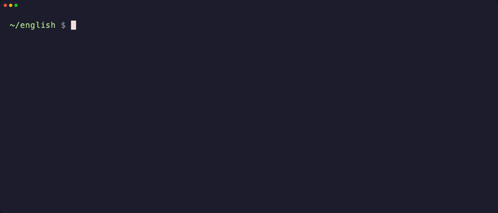
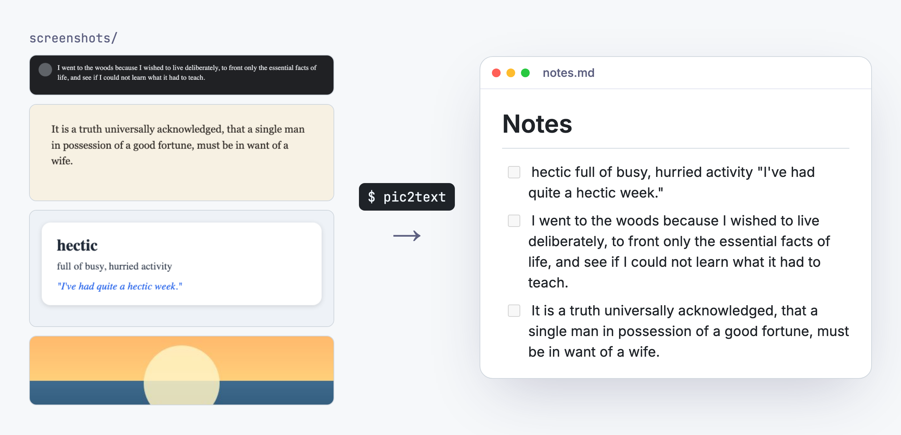
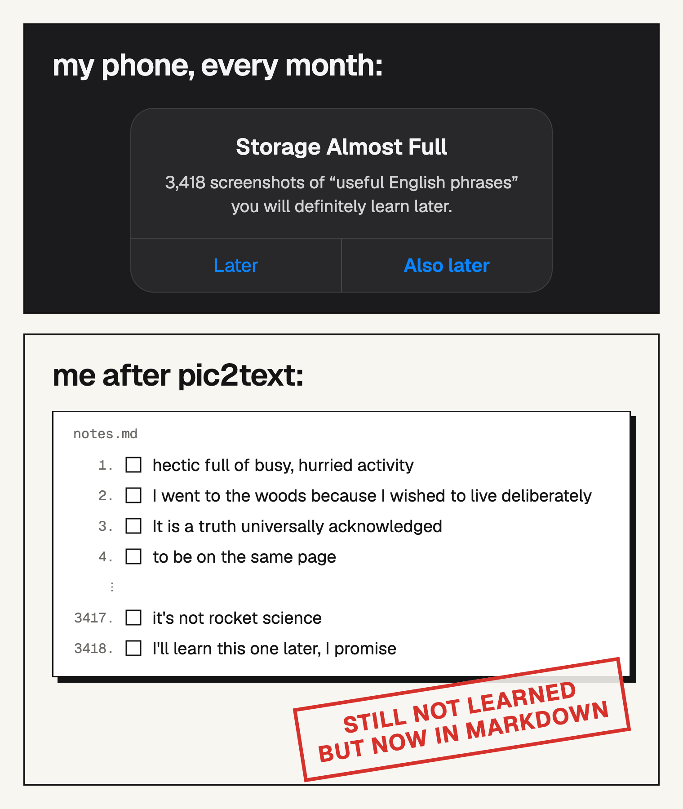

* 🧳 Launched February 2026
* 🚪 Release v0.2.0
* 📦 Code size 9 KB, 16 tests

[](https://github.com/vinter-man/pic-to-text-english/actions/workflows/ci.yml)   [](LICENSE)

## Short description
You see a good English phrase in a book, a chat or a talk caption. You take a screenshot. You never look at it again.

pic2text fixes the last part. Throw the screenshots into a folder, run one command, and get a numbered Markdown checklist with the text from every picture. Tick the phrases off as you learn them.

OCR runs on your own machine. No API keys, no uploads, no 2 GB of PyTorch. Run it as often as you like: it only reads new screenshots and never adds the same one twice.


---

## Table of contents

* [How I use it](#how-i-use-it)
  * [Drop screenshots](#drop)
  * [Run it](#run)
  * [Learn](#learn)
* [Installation](#installation)
* [Options](#options)
* [Development](#development)
* [Contact](#contact)

---
---

## <a name="how-i-use-it"></a> How I use it
### <a name="drop"></a> Drop screenshots
I read a book, scroll a chat or watch a talk with subtitles, and as soon as a phrase is worth stealing, I take a screenshot. At the end of the week they all go into one folder:

```
~/english/screenshots/
├── IMG_2041.png
├── IMG_2042.jpg
├── Screenshot 2026-10-12 at 09.14.03.png
└── Screenshot 2026-10-12 at 21.40.55.png
```

PNG, JPG, WebP, BMP and TIFF are all fine. Names don't matter.

### <a name="run"></a> Run it
```
cd ~/english
pic2text
```



That's a real recording, not a mockup ([`demo/demo.tape`](demo/demo.tape) runs the CLI on [`examples/screenshots`](examples/screenshots)). One image was a sunset with no text, so it was skipped. The second run has nothing to do and says so.

> :suspect: Under the hood:
> - every image gets a fingerprint (SHA-256 of its bytes), and fingerprints already in `notes.md` are skipped. Rename a file or save it twice, still no duplicate. If nothing is new, the model isn't even loaded
> - OCR is [RapidOCR](https://github.com/RapidAI/RapidOCR): PaddleOCR's PP-OCR models on ONNX Runtime. The models ship inside the wheel, so after install it works without internet
> - fragments with a low confidence score are thrown away. They're almost always avatars and icons read as `:o:`
> - the remaining lines are glued into one paragraph, and `multi-` + `hundred` become `multi-hundred` again
>
> `src/pic2text/cli.py` → `ocr.py` → `document.py`, about 270 lines in total

### <a name="learn"></a> Learn
Open `notes.md` in Obsidian, VS Code, Typora or right here on GitHub. It's a plain checklist:

<picture>
  <source media="(prefers-color-scheme: dark)" srcset="docs/result-dark.png">
  
</picture>

Learned a phrase? Tick it. Reworded something? Fine. Added your own line by hand? Also fine. The file only ever grows, and the next run continues the numbering from wherever you are.

> :hurtrealbad: Every line has an HTML comment with the fingerprint of its screenshot. You can't see it when the file is rendered, but you can see it in the raw file, so you always know where a phrase came from:
> ```markdown
> 2. [ ] I went to the woods because I wished to live deliberately, … <!-- pic2text 761863ec1ed7 Screenshot 2026-10-12 at 09.14.03.png -->
> ```
> Screenshots with no text get a comment-only line, so they aren't read again either. The file that example came from is [`examples/notes.md`](examples/notes.md)

---
---

## <a name="installation"></a> Installation
Install [uv](https://docs.astral.sh/uv/getting-started/installation/). It brings the right Python by itself
```
uv tool install git+https://github.com/vinter-man/pic-to-text-english
```
> `pipx install git+https://github.com/vinter-man/pic-to-text-english` works the same way

The first run takes a couple of seconds to load the model. After that it's under a second per screenshot on a laptop CPU, with no GPU needed

## <a name="options"></a> Options
```
pic2text [folder] [-o OUTPUT] [--title TITLE] [--min-confidence 0-1]
```

| Option | Default | What it does |
| --- | --- | --- |
| `folder` | `./screenshots` | where to look for images (not recursive) |
| `-o, --output` | `./notes.md` | the Markdown file to create or append to |
| `--title` | `Notes` | the heading written when the file is created |
| `--min-confidence` | `0.75` | drop OCR fragments scored below this |

A separate list for every book
```
pic2text ~/Pictures/dune -o dune.md --title "Dune: phrases"
```
Straight into the Obsidian vault
```
pic2text ~/Desktop/screens -o ~/Obsidian/English/inbox.md
```
Garbage from icons in the output? Raise the threshold. Words missing from a blurry phone photo? Lower it
```
pic2text --min-confidence 0.9
pic2text --min-confidence 0.5
```

> :rage1: What it can't do (yet):
> - it reads everything it sees: the sender's name, the time, the page number. Crop the screenshot to the phrase, or fix the line afterwards
> - one screenshot is one paragraph. Columns and tables come out as one long line
> - the bundled models are made for English and other Latin-script languages

---
---

## <a name="development"></a> Development
```
git clone https://github.com/vinter-man/pic-to-text-english && cd pic-to-text-english
uv sync
uv run pytest               # unit tests + a real OCR run over examples/screenshots
uv run pytest -m "not ocr"  # without loading the model
uv run ruff check . && uv run ruff format --check .
```
CI runs the same checks on Linux, macOS and Windows with Python 3.11 and 3.14.

> :godmode: Every picture in this README is generated by code in [`demo/`](demo), nothing was drawn by hand:
> - [`demo.tape`](demo/demo.tape) records the real terminal with [VHS](https://github.com/charmbracelet/vhs)
> - [Remotion](https://www.remotion.dev) in [`demo/src`](demo/src) renders the banner, the video, the meme and the before/after picture. The video plays that same terminal recording, and the right-hand side of the before/after picture is `examples/notes.md` rendered by GitHub's own Markdown API
>
> ```
> cd demo && npm install && npm run build   # needs vhs, ffmpeg, webp, gh
> npm run studio                            # play with the video in the browser
> ```
>
> The example screenshots contain public-domain text (Thoreau's *Walden*, Austen's *Pride and Prejudice*) and a flashcard I made up

---
---

## <a name="contact"></a> Contact

* Telegram - https://t.me/vindemure
* Mail - serhiivinterman@gmail.com

---
---


